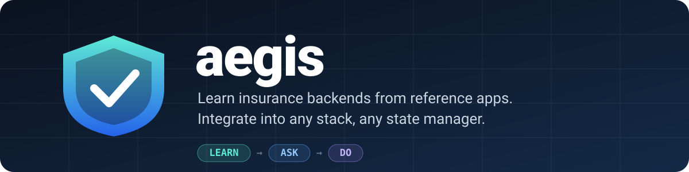
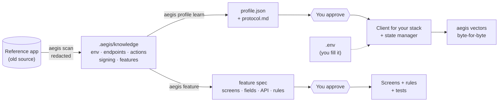

<div align="center">



<h3>Learn an insurance backend and its business features from a reference app — then integrate them into any stack and any state manager.</h3>

[](https://github.com/nvdhai2003mobiledev/aegis/actions/workflows/ci.yml)
[](https://www.npmjs.com/package/aegis-insurance)
[](LICENSE)
[](https://nodejs.org)
[](package.json)
[](https://agentskills.io)

[Tiếng Việt](README.md) · **English**

[Install](#-install) · [Quick start](#-quick-start) · [How it works](#-how-it-works) · [Support](#-supported-stacks--state-managers) · [Commands](#-commands) · [Security](#-security) · [FAQ](#-faq)

</div>

---

**aegis** is an **Agent Skills + CLI** kit for Claude Code, Codex, Cursor and every [Agent Skills](https://agentskills.io) host. Point your agent at an existing insurance app: it **learns** how the backend works and what each feature does from that source code, **asks** you at the points where a human must decide, then **does** the work — building the service layer and screens on a new stack, with request signatures verified byte-for-byte against the old app.

The kit **ships no company data**. All real knowledge is learned at run time and lives only in your private project.

## ✨ Why aegis

New insurance apps usually start as a _clone of an old one_. Fast — but the new app inherits the old framework, state manager, HTTP client and structure. Switching technology means rediscovering how requests are signed, how expired sessions are handled, what hundreds of action codes mean, and which business rules hide in which screens.

| Cloning the old app                     | With aegis                                         |
| --------------------------------------- | -------------------------------------------------- |
| Locked into the old tech                | Any stack, any state manager                       |
| Knowledge implicit in code              | Explicit knowledge with `file:line` sources        |
| Agent guesses "usually…"                | Agent may not guess — no source, it asks           |
| Signature drift → cryptic server errors | Test vectors match the old algorithm byte-for-byte |
| Secrets travel with the code            | Secrets only in `.env`, redacted on read           |

## 🚀 Install

**macOS / Linux**

```bash
curl -fsSL https://raw.githubusercontent.com/nvdhai2003mobiledev/aegis/main/install.sh | sh
```

**Windows (PowerShell)**

```powershell
irm https://raw.githubusercontent.com/nvdhai2003mobiledev/aegis/main/install.ps1 | iex
```

**npm**

```bash
npx aegis-insurance
```

Run it from the root of the project you are integrating. The installer adds the skills for **Claude Code** (`~/.claude/skills`) and **Codex** (`~/.agents/skills`), installs the `aegis` CLI into `~/.aegis/bin`, and configures the current project (a rules block in `CLAUDE.md`/`AGENTS.md`, `.aegis/`, `.env.example`, `.gitignore`). No sudo, no shell-profile edits, no dependencies.

<details>
<summary><b>Other ways to install</b></summary>

| Channel                 | Command                                                                                | Installs     |
| ----------------------- | -------------------------------------------------------------------------------------- | ------------ |
| Claude Code plugin      | `/plugin marketplace add nvdhai2003mobiledev/aegis` then `/plugin install aegis@aegis` | Skills       |
| Skills CLI (70+ agents) | `npx skills add nvdhai2003mobiledev/aegis`                                             | Skills       |
| From GitHub             | `npx github:nvdhai2003mobiledev/aegis`                                                 | Skills + CLI |
| Pinned version          | `curl -fsSL …/install.sh \| AEGIS_VERSION=v0.2.0 sh`                                   | Skills + CLI |

Installer flags (after `sh -s --` or `npx aegis-insurance`): `--project` (install skills into the project instead of globally), `--skills-only` (don't configure the current directory), `--hooks` (add a secret-scanning pre-commit hook).

Update: `aegis update` · Remove: `aegis uninstall` (your `.aegis/` is kept).

</details>

> Restart your Claude Code / Codex session after installing so the skills load.

## ⚡ Quick start

```bash
aegis ref add ~/code/old-insurance-app   # or a git URL — read-only clone
aegis scan                               # learn: environments, endpoints, actions, signing layer, features
aegis doctor                             # readiness level and the next step
```

Then tell your agent:

> **"Integrate the insurance backend into this project."**
>
> **"Build the car-inspection feature like the old app."**

The agent writes a protocol profile and a feature spec (every line sourced), **stops for your approval**, then generates and verifies code.

## 🧭 How it works



| Phase     | The agent                                                                                                                                                  | Tools                                         |
| --------- | ---------------------------------------------------------------------------------------------------------------------------------------------------------- | --------------------------------------------- |
| **Learn** | Reads the reference app: environments (secrets redacted), endpoints, action codes, HTTP/signing/session layer, feature tree. Never answers from memory.    | `scan` · `profile learn` · `feature` · `diff` |
| **Ask**   | Stops at gates: profile approval, which app is canonical when apps differ, secrets you type yourself, feature-spec approval, before calling a real server. | `aegis-integrate` · `aegis-feature` skills    |
| **Do**    | Generates a profile-driven client, wires the store, runs signature vectors, compares requests with the old app, smoke-tests when allowed.                  | `vectors` · `profile check` · `doctor`        |

No reference source on your machine? aegis falls back: read-only git clone → `aegis import` from a project that already learned → **protocol-only mode** (API docs / Q&A, action codes as `<ACTION:KEY>` placeholders that `aegis doctor` tracks).

## 🧩 What's inside

| Skill                      | Use it for                                                                                                   |
| -------------------------- | ------------------------------------------------------------------------------------------------------------ |
| **`aegis-integrate`**      | Entry point — "integrate the backend", "move this app to a new stack"                                        |
| **`aegis-learn`**          | Reading the old source, writing the profile, generating vectors, insurance glossary                          |
| **`aegis-protocol`**       | Client core: envelope, signing recipes, response classification, session policy, upload, SSO, payments, push |
| **`aegis-stack-adapters`** | Porting the core to each stack and wiring each state manager                                                 |
| **`aegis-feature`**        | Extract a feature → sourced spec → approval → code + tests                                                   |

Plus **profile-driven reference clients** in [TypeScript](reference/ts) and [Dart](reference/dart) sharing one [vector set](profiles/demo/vectors.json), and specs for the [profile](spec/profile-schema.md), [signing recipes](spec/signing-recipes.md) and [`.aegis/` format](spec/knowledge-format.md).

## 📱 Supported stacks & state managers

| Stack            |                | State manager  |     |
| ---------------- | -------------- | -------------- | --- |
| React Native     | ✅             | Redux Toolkit  | ✅  |
| Expo             | ✅             | RTK Query      | ✅  |
| React / Next.js  | ✅             | Zustand        | ✅  |
| Vue / Nuxt       | ✅             | TanStack Query | ✅  |
| Flutter          | ✅ Dart client | Jotai          | ✅  |
| Android (Kotlin) | ✅ guide       | MobX           | ✅  |
| iOS (Swift)      | ✅ guide       | Pinia          | ✅  |
|                  |                | Riverpod       | ✅  |
|                  |                | Bloc / Cubit   | ✅  |

## 🛠 Commands

| Learn                           | Verify                      | Manage                                |
| ------------------------------- | --------------------------- | ------------------------------------- |
| `aegis ref add <path\|git-url>` | `aegis vectors [--demo]`    | `aegis install [--project] [--hooks]` |
| `aegis scan [--ref]`            | `aegis profile check`       | `aegis update` · `aegis uninstall`    |
| `aegis profile learn\|show`     | `aegis doctor [--json]`     | `aegis import <path\|git-url>`        |
| `aegis feature <name>`          | `aegis scan-secrets [path]` | `aegis action add\|list [--missing]`  |
| `aegis diff --ref a --ref b`    |                             | `aegis doc add <file>`                |

## 🔒 Security

- **The kit contains no real data** — methods, generic signing recipes and a fictional `demo` profile only. CI enforces it with [`secret-scan`](scripts/secret-scan.mjs); maintainers add a local denylist kept outside the repo.
- **Redaction on read** — secrets by field name, long hex, JWTs, API keys, private keys, every URL — plus a final guard that refuses to write `.aegis/` if anything secret-looking remains.
- **Secrets only in `.env`** — the agent never copies secrets from the old app or writes them to code, `.aegis/`, logs or replies. `aegis doctor` flags a git-tracked `.env`.
- **No machine-local data in committed files** (local paths live in the gitignored `.aegis/local.json`).

See [SECURITY.md](SECURITY.md).

## ❓ FAQ

<details>
<summary><b>Does aegis send my code anywhere?</b></summary>

No. The CLI is local-only with zero dependencies and no network calls — except `ref add <git-url>` / `import <git-url>` (cloned with your own git credentials) and `update`.

</details>

<details>
<summary><b>My old app isn't React Native / axios / Redux.</b></summary>

The scanner looks for signals (HTTP clients, signing functions, constant tables, route declarations) across JS/TS, Dart, Kotlin, Swift and Vue. Unknown layouts get low confidence plus a list of files for the agent to read by hand.

</details>

<details>
<summary><b>Our backend signs requests differently.</b></summary>

The protocol is a [profile](spec/profile-schema.md): envelope, headers, signing recipe, response classification, session policy. If no recipe fits, the agent records an open question instead of forcing one — and you can [contribute a recipe](CONTRIBUTING.md).

</details>

## 🤝 Contributing

Adapters for new stacks/state managers, new signing recipes and scanner heuristics are very welcome — see [CONTRIBUTING.md](CONTRIBUTING.md). One non-negotiable rule: **no real company data in this repo.**

## 📄 License

[MIT](LICENSE). The _Learn → Ask → Do_.
