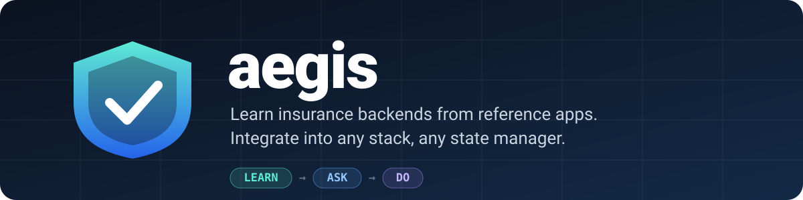
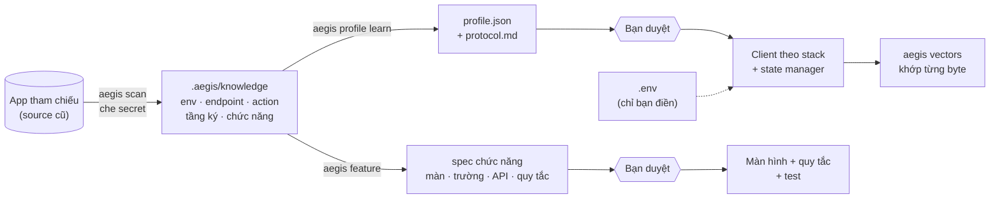

<div align="center">



<h3>Học backend & nghiệp vụ bảo hiểm từ app tham chiếu — tích hợp vào mọi stack, mọi state manager.</h3>

[](https://github.com/nvdhai2003mobiledev/aegis/actions/workflows/ci.yml)
[](https://www.npmjs.com/package/aegis-insurance)
[](LICENSE)
[](https://nodejs.org)
[](package.json)
[](https://agentskills.io)

**Tiếng Việt** · [English](README.en.md)

[Cài đặt](#-cài-đặt) · [Bắt đầu nhanh](#-bắt-đầu-nhanh) · [Cách hoạt động](#-cách-hoạt-động) · [Hỗ trợ](#-stack--state-manager-được-hỗ-trợ) · [Lệnh](#-lệnh) · [Bảo mật](#-bảo-mật) · [FAQ](#-faq)

</div>

---

**aegis** là bộ **Agent Skills + CLI** cho Claude Code, Codex, Cursor và mọi agent hỗ trợ [Agent Skills](https://agentskills.io). Bạn chỉ cho agent một app bảo hiểm cũ; agent **học** cách backend hoạt động và nghiệp vụ từng chức năng từ chính source code đó, **hỏi** bạn ở những điểm cần con người quyết, rồi **làm**: dựng tầng service và các màn hình trên stack mới, kèm kiểm chứng chữ ký request khớp từng byte với app cũ.

Kit **không chứa dữ liệu của công ty nào**. Mọi kiến thức thật được học lúc chạy và chỉ nằm trong project private của bạn.

## ✨ Vì sao cần aegis

Làm app bảo hiểm mới thường bắt đầu bằng *clone app cũ*. Nhanh — nhưng app mới bị khoá vào framework, state manager, HTTP client và cách tổ chức của app gốc. Muốn đổi công nghệ là phải mò lại từ đầu: request được ký thế nào, phiên hết hạn xử lý ra sao, hàng trăm mã action nghĩa là gì, quy tắc nghiệp vụ nằm rải rác ở màn hình nào.

| Clone app cũ | Với aegis |
|---|---|
| Khoá vào công nghệ cũ | Chọn stack & state manager tuỳ ý |
| Kiến thức nằm ngầm trong code | Kiến thức tường minh, có nguồn `file:line` |
| Agent đoán dựa trên "thường thì…" | Agent bị cấm đoán — không có nguồn thì hỏi |
| Lệch chữ ký → lỗi khó hiểu trên server | Test vector khớp từng byte với thuật toán cũ |
| Secret theo code đi khắp nơi | Secret chỉ ở `.env`, scanner che khi đọc |

## 🚀 Cài đặt

**macOS / Linux**

```bash
curl -fsSL https://raw.githubusercontent.com/nvdhai2003mobiledev/aegis/main/install.sh | sh
```

**Windows (PowerShell)**

```powershell
irm https://raw.githubusercontent.com/nvdhai2003mobiledev/aegis/main/install.ps1 | iex
```

**npm**

```bash
npx aegis-insurance
```

Chạy trong thư mục gốc của project cần tích hợp. Installer cài skill cho **Claude Code** (`~/.claude/skills`) và **Codex** (`~/.agents/skills`), cài CLI `aegis` vào `~/.aegis/bin`, rồi cấu hình project hiện tại (khối luật trong `CLAUDE.md`/`AGENTS.md`, `.aegis/`, `.env.example`, `.gitignore`). Không cần sudo, không sửa file cấu hình shell, không cài dependency nào.

<details>
<summary><b>Cách cài khác</b></summary>

| Kênh | Lệnh | Cài gì |
|---|---|---|
| Claude Code plugin | `/plugin marketplace add nvdhai2003mobiledev/aegis` rồi `/plugin install aegis@aegis` | Skill |
| Skills CLI (70+ agent) | `npx skills add nvdhai2003mobiledev/aegis` | Skill |
| Từ GitHub | `npx github:nvdhai2003mobiledev/aegis` | Skill + CLI |
| Phiên bản cố định | `curl -fsSL …/install.sh \| AEGIS_VERSION=v0.2.0 sh` | Skill + CLI |

Tuỳ chọn installer (truyền sau `sh -s --` hoặc `npx aegis-insurance`):

| Cờ | Ý nghĩa |
|---|---|
| `--project` | cài skill vào project (`.claude/skills`, `.agents/skills`) thay vì global |
| `--skills-only` | chỉ cài skill + CLI, không cấu hình thư mục hiện tại |
| `--hooks` | thêm pre-commit quét secret vào project |

Cập nhật: `aegis update` · Gỡ: `aegis uninstall` (giữ nguyên `.aegis/` của bạn).

</details>

> Khởi động lại phiên Claude Code / Codex sau khi cài để nạp skill.

## ⚡ Bắt đầu nhanh

```bash
aegis ref add ~/code/app-bao-hiem-cu     # hoặc git-url — clone chỉ đọc
aegis scan                               # học: môi trường, endpoint, action, tầng ký, chức năng
aegis doctor                             # đang ở mức nào, bước tiếp theo là gì
```

```text
✔ app-bao-hiem-cu @ 3f2a9c1e0b7d → .aegis/knowledge/app-bao-hiem-cu
  stack: react-native · state: redux-toolkit · http: axios
  môi trường 3 · endpoint 96 · action 412 · message 58 · route 240 · chức năng 180
  độ tin cậy: environments=high endpoints=high actions=high protocol=high features=high
```

Rồi nói với agent:

> **"Tích hợp backend bảo hiểm vào project này."**
>
> **"Làm chức năng giám định ô tô như app cũ."**

Agent sẽ viết profile giao thức và spec chức năng (mỗi dòng có nguồn), **dừng lại cho bạn duyệt**, rồi mới sinh code và kiểm chứng.

## 🧭 Cách hoạt động



| Pha | Agent làm | Công cụ |
|---|---|---|
| **Học** | Đọc app tham chiếu: cấu hình môi trường (đã che secret), endpoint, mã action, tầng HTTP/ký/phiên, cây chức năng. Không trả lời từ trí nhớ. | `scan` · `profile learn` · `feature` · `diff` |
| **Hỏi** | Dừng ở các cổng: duyệt profile, chọn app chuẩn khi các app khác nhau, bạn tự điền secret, duyệt spec chức năng, trước khi gọi server thật. | skill `aegis-integrate` · `aegis-feature` |
| **Làm** | Sinh client chạy theo profile, nối store, test vector chữ ký, so request với app cũ, smoke test khi được phép. | `vectors` · `profile check` · `doctor` |

Không có source app cũ trên máy? aegis tự lùi dần: clone từ git (chỉ đọc) → `aegis import` từ một project đã học → **chế độ chỉ giao thức** (tài liệu API / hỏi đáp, mã action để `<ACTION:KEY>` và `aegis doctor` liệt kê mã còn thiếu).

## 🧩 Thành phần

| Skill | Dùng khi |
|---|---|
| **`aegis-integrate`** | Điểm vào — "tích hợp backend", "chuyển app sang stack mới" |
| **`aegis-learn`** | Đọc source app cũ, viết profile, sinh vector, thuật ngữ bảo hiểm |
| **`aegis-protocol`** | Lõi client: envelope, công thức ký, phân loại response, chính sách phiên, upload, SSO, thanh toán, push |
| **`aegis-stack-adapters`** | Dịch lõi sang từng stack và nối vào từng state manager |
| **`aegis-feature`** | Trích chức năng → spec có nguồn → duyệt → code + test |

Kèm theo: **client mẫu chạy theo profile** bằng [TypeScript](reference/ts) và [Dart](reference/dart) dùng chung một bộ [vector](profiles/demo/vectors.json); đặc tả [profile](spec/profile-schema.md), [công thức ký](spec/signing-recipes.md), [định dạng `.aegis/`](spec/knowledge-format.md).

## 📱 Stack & state manager được hỗ trợ

| Stack | | State manager | |
|---|---|---|---|
| React Native | ✅ | Redux Toolkit | ✅ |
| Expo | ✅ | RTK Query | ✅ |
| React / Next.js | ✅ | Zustand | ✅ |
| Vue / Nuxt | ✅ | TanStack Query | ✅ |
| Flutter | ✅ client Dart | Jotai | ✅ |
| Android (Kotlin) | ✅ hướng dẫn | MobX | ✅ |
| iOS (Swift) | ✅ hướng dẫn | Pinia | ✅ |
| | | Riverpod | ✅ |
| | | Bloc / Cubit | ✅ |

Mỗi hướng dẫn nêu: nơi đặt file, HTTP transport, thư viện crypto, cách serialize JSON giữ đúng byte, secure storage cho phiên, device id, biến môi trường, và cách nối `SessionStore` + hooks.

## 🛠 Lệnh

| Học | Kiểm chứng | Quản lý |
|---|---|---|
| `aegis ref add <path\|git-url>` | `aegis vectors [--demo]` | `aegis install [--project] [--hooks]` |
| `aegis scan [--ref]` | `aegis profile check` | `aegis update` · `aegis uninstall` |
| `aegis profile learn\|show` | `aegis doctor [--json]` | `aegis import <path\|git-url>` |
| `aegis feature <tên>` | `aegis scan-secrets [path]` | `aegis action add\|list [--missing]` |
| `aegis diff --ref a --ref b` | | `aegis doc add <file>` |

`aegis --help` để xem đầy đủ.

## 🔒 Bảo mật

aegis được thiết kế để repo này **public** mà không lộ gì, và để project của bạn không làm lộ secret.

- **Kit không chứa dữ liệu thật.** Chỉ phương pháp, công thức ký tổng quát và profile `demo` bịa. CI chặn bằng [`secret-scan`](scripts/secret-scan.mjs); người bảo trì dùng thêm denylist local ngoài repo.
- **Che secret ngay lúc đọc.** Secret theo tên trường, hex dài, JWT, API key, private key, mọi URL. Có chốt chặn cuối: từ chối ghi `.aegis/` nếu còn chuỗi giống secret.
- **Secret chỉ ở `.env`.** Agent không tự lấy secret từ app cũ, không ghi vào code, `.aegis/`, log hay câu trả lời. `aegis doctor` báo động nếu `.env` bị git theo dõi.
- **Không có dữ liệu máy cá nhân** trong file được commit (đường dẫn local nằm trong `.aegis/local.json`, đã gitignore).

Chi tiết và cách báo lỗi bảo mật: [SECURITY.md](SECURITY.md).

## ❓ FAQ

<details>
<summary><b>aegis có gửi code của tôi đi đâu không?</b></summary>

Không. CLI chạy hoàn toàn local, không có dependency, không gọi mạng — trừ khi bạn dùng `ref add <git-url>` / `import <git-url>` (clone bằng quyền git của chính bạn) hoặc `update`.
</details>

<details>
<summary><b>App cũ của tôi không dùng React Native / axios / Redux thì sao?</b></summary>

Scanner không giả định bố cục: nó tìm theo tín hiệu (HTTP client, hàm ký, bảng hằng số, khai báo route) trên JS/TS, Dart, Kotlin, Swift, Vue. Bố cục lạ → độ tin cậy thấp, kèm danh sách file để agent đọc tay theo `aegis-learn`.
</details>

<details>
<summary><b>Backend của công ty tôi ký request kiểu khác?</b></summary>

Giao thức được mô tả bằng một [profile](spec/profile-schema.md): envelope, header, công thức ký (`hash-b64url-dot-secret`, `jws-hs256`, `hmac-sha256`, `kv-string-hash`…), phân loại response, chính sách phiên. Không có công thức phù hợp → agent ghi vào câu hỏi mở thay vì ép; bạn có thể [đóng góp công thức mới](CONTRIBUTING.md).
</details>

<details>
<summary><b>Secret nằm trong app mobile có an toàn không?</b></summary>

Không — secret trong app đã build luôn trích xuất được. Đó là thiết kế của backend, aegis không thay đổi được, nhưng skill sẽ nói rõ điều này và gợi ý chuyển việc ký sang server/BFF (Next.js, Nuxt có hướng dẫn sẵn).
</details>

## 🗺 Lộ trình

- [ ] Client mẫu Kotlin & Swift có test vector
- [ ] `aegis feature --all`: sinh spec hàng loạt
- [ ] Nhận diện sẵn thêm bố cục (Clean Architecture Flutter, Android MVVM)
- [ ] Profile mẫu cho các kiểu backend phổ biến (REST + Bearer, OAuth2)

## 🤝 Đóng góp

Rất hoan nghênh — đặc biệt là adapter cho stack/state mới, công thức ký mới, heuristic scanner. Xem [CONTRIBUTING.md](CONTRIBUTING.md). Luật duy nhất không thương lượng: **không đưa dữ liệu thật của bất kỳ công ty nào vào repo.**

## 📄 Giấy phép

[MIT](LICENSE). Mô hình *Learn → Ask → Do* lấy cảm hứng từ [pythia](https://github.com/thaildhe172591/pythia).
